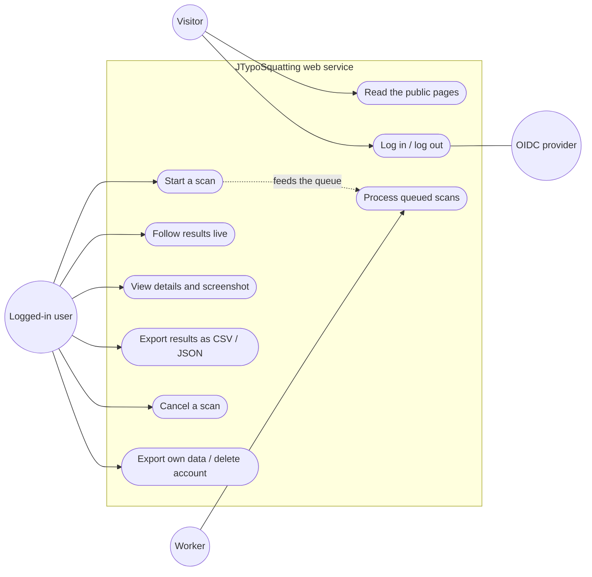
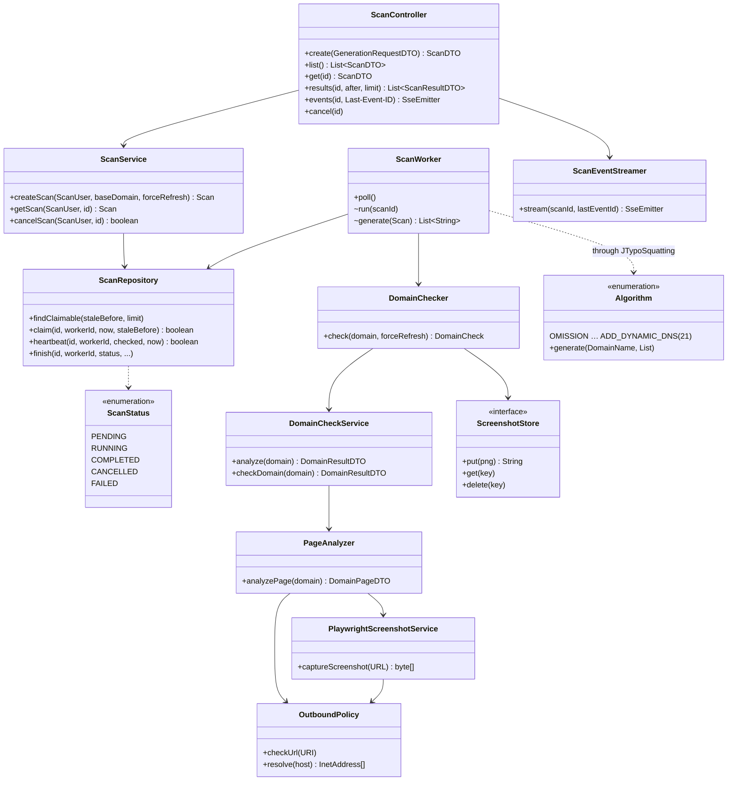
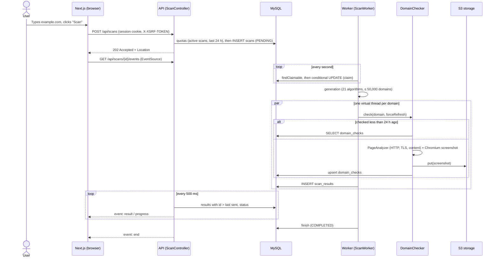
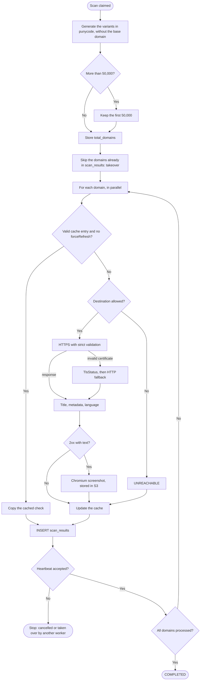
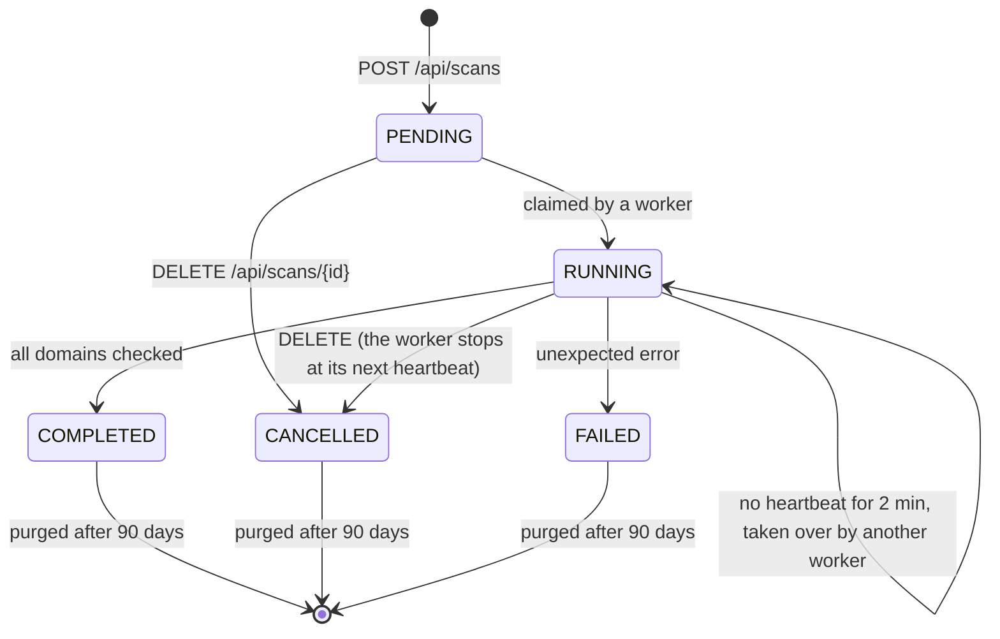
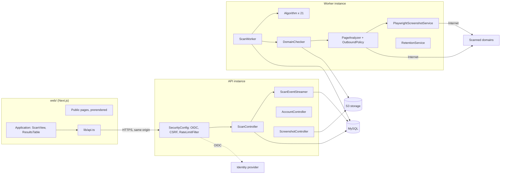
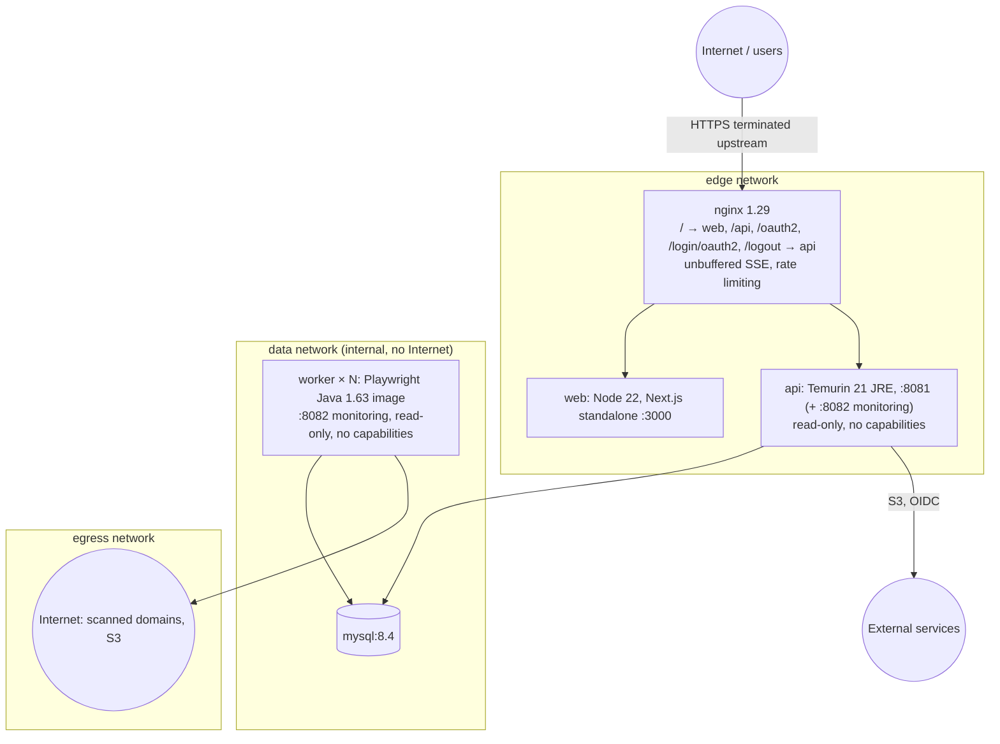
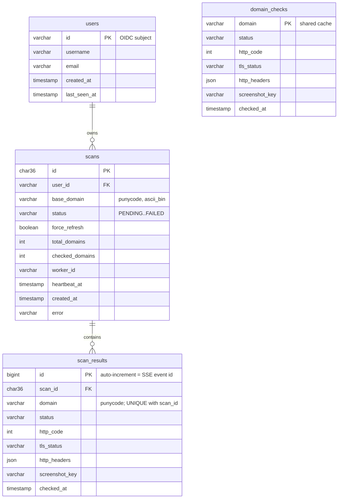

# Technical Architecture — JTypoSquatting v2.0

Detailed architecture reference of **JTypoSquatting** (branch `feature/web-public`), with UML diagrams.
JTypoSquatting detects typosquatting of domain names, for security analysts and brand protection teams.
The condensed overview is [ARCHITECTURE.md](ARCHITECTURE.md).

---

## Table of Contents

1. [Overview](#1-overview)
2. [Scope and Requirements](#2-scope-and-requirements)
3. [Application Architecture](#3-application-architecture)
4. [Technical and Runtime Architecture](#4-technical-and-runtime-architecture)
5. [The 7 UML Diagrams](#5-the-7-uml-diagrams)
   - [5.1 Use Cases](#51-use-case-diagram)
   - [5.2 Classes](#52-class-diagram)
   - [5.3 Sequence](#53-sequence-diagram)
   - [5.4 Activity](#54-activity-diagram)
   - [5.5 State Machine](#55-state-machine-diagram)
   - [5.6 Components](#56-component-diagram)
   - [5.7 Deployment](#57-deployment-diagram)
6. [Data Architecture](#6-data-architecture)
7. [Network Flows and API](#7-network-flows-and-api)
8. [Security Model](#8-security-model)
9. [Performance and Concurrency](#9-performance-and-concurrency)
10. [Operations](#10-operations)

---

## 1. Overview

JTypoSquatting is a **public, multi-user web service**. It is made of:

- **Web frontend**: **Next.js 16** (React 19, App Router), in French and English. Public pages are prerendered;
  the scan application is rendered in the browser.
- **API instances**: **Spring Boot 3.5** on **Jetty**, profile `api`. They serve the REST API and one
  Server-Sent Events stream per scan, handle OpenID Connect login, and keep sessions in the database
  (Spring Session JDBC).
- **Workers**: the same Spring Boot artifact, profile `worker`. They take queued scans from MySQL, generate
  the variants, check each domain (HTTP, TLS, content) and capture pages with **headless Chromium (Playwright)**.
- **Data**: **MySQL 8.4** (schema managed by Flyway) and **S3-compatible** object storage for screenshots.
- **Identity**: an **OpenID Connect** provider (Keycloak in development).
- **Entry point**: **nginx**, which serves the frontend and the API on the same origin.

The original **desktop application** (Swing) still works. The all-in-one JAR starts the backend in `local`
mode (no login, API bound to 127.0.0.1, in-memory H2 database) with the legacy endpoints.

---

## 2. Scope and Requirements

| Area | Requirement | Implementation |
|---|---|---|
| Generation | Plausible variants of a domain | 21 algorithms (`Algorithm` registry), up to 50,000 domains per scan |
| Multi-user | Accounts, with scans and results kept apart | OIDC; ownership checked on every scan, result and screenshot |
| Robustness | Scans survive a closed tab, a restart or a worker failure | Persistent job queue, heartbeat, takeover |
| Real time | Results shown as they come | One SSE stream per scan, resumable with `Last-Event-ID` |
| Security | Generated domains may be controlled by an attacker | Anti-SSRF policy, strict TLS, isolated Chromium, quotas |
| Visual capture | Spot phishing and parked domains | 1280×800 PNG of 2xx pages that contain text |
| Compliance | GDPR | Data export, account deletion, retention purge |

---

## 3. Application Architecture

The project has three Gradle modules and one npm project:

```
JTypoSquatting/
├── shared/     Common DTOs (DomainResultDTO, DomainPageDTO, GenerationRequestDTO, DomainStatus, TlsStatus), DomainName
├── backend/    Spring Boot: API, workers, generators, analysis engine, persistence, security
├── frontend/   Swing desktop client (JTypoFrame) and CombinedLauncher (all-in-one JAR)
└── web/        Next.js frontend, Playwright end-to-end tests
```

### 3.1 `backend` module

| Package | Role | Main classes |
|---|---|---|
| `scan` | Scans: API, queue, worker, SSE stream, shared cache | `ScanController`, `ScanService`, `ScanRepository`, `ScanWorker`, `ScanEventStreamer`, `DomainChecker`, `DomainCheckRepository`, `ScanResultRepository`, `UserRepository` |
| `generator` | The 21 generation algorithms | `Algorithm`, `CharacterEdits`, `Keyboard`, `DotDash`, `Dash`, `Homoglyph`, `Misspell`, `Words`, `Suffixes`, `TLD`, `DomainParts` |
| `service` | Analysis of one domain | `DomainCheckService`, `PageAnalyzer`, `PlaywrightScreenshotService` |
| `security` | Outbound network policy (anti-SSRF) | `OutboundPolicy`, `GuardedDnsResolver` |
| `config` | Security chains, OIDC client, scheduling | `SecurityConfig`, `LazyClientRegistrationRepository`, `JsonLogoutSuccessHandler`, `SchedulingConfig` |
| `abuse` | Rate limiting, quota errors (429) | `RateLimitFilter`, `QuotaExceptionHandler` |
| `storage` | Screenshots outside the database | `ScreenshotStore` (S3, filesystem), `ScreenshotController`, `ScreenshotGarbageCollector` |
| `account` | Data export and account deletion (GDPR) | `AccountController`, `AccountService` |
| `retention` | Nightly purge | `RetentionService` |
| `persistence` | Stored form of domain names (punycode) | `DomainKeys` |
| `controller`, `db` | Current user; legacy desktop API (`local` mode only) | `UserController`, `TypoSquattingController`, `DomainDataController`, `DatabaseService` |

### 3.2 `web` project

| Element | Role |
|---|---|
| `src/app/[locale]/…` | Public pages (home, how it works, FAQ, legal notice, terms, privacy). `app/`: history, form, "My data". `app/scans/[id]/`: live scan |
| `src/proxy.ts` | Picks the language prefix (`/fr` or `/en`) from `Accept-Language`, with next-intl |
| `src/lib/api.ts` | API client: session cookie, CSRF token, `EventSource` |
| `src/components/` | `ScanView` (live stream applied in batches), `ResultsTable` (virtualised), `ResultDetails`, `ExternalLinkWarning`, `AccountData` |
| `messages/fr.json`, `en.json` | Translation catalogs |

### 3.3 `frontend` module (desktop)

`JTypoFrame` (Swing) uses the legacy endpoints. `CombinedLauncher` starts the backend in the same JVM, with
`jtypo.security.mode=local`, `server.address=127.0.0.1` and raised quotas, then opens the window.

---

## 4. Technical and Runtime Architecture

| Layer | Technologies |
|---|---|
| Frontend | Next.js 16.4, React 19.3, TypeScript 5.9, Tailwind 4, next-intl 4, TanStack Virtual |
| API and workers | Java 21 (virtual threads), Spring Boot 3.5, Jetty, Spring Security 6.5 (OAuth2 client, PKCE), Spring Session JDBC |
| Analysis | Apache HttpClient 5.6 (filtering DNS resolver), JSoup, Lingua (12 languages), Guava `InternetDomainName`, Playwright for Java 1.63 |
| Data | MySQL 8.4 + Flyway (H2 for the desktop app and tests), AWS SDK v2 for S3 |
| Operations | Actuator, Micrometer/Prometheus, JSON logs (ECS), Docker, nginx, GitHub Actions |

Runtime roles of the single artifact `jtyposquatting-backend.jar`:

| Role | Activation | HTTP | Worker | Security |
|---|---|---|---|---|
| Development | no profile | :8081 | yes | OIDC |
| API | `SPRING_PROFILES_ACTIVE=api` | :8081 (API), :8082 (monitoring) | no | OIDC |
| Worker | `SPRING_PROFILES_ACTIVE=worker` | :8082 (monitoring only, `jtypo.api.enabled=false`) | yes | — |
| Desktop | `CombinedLauncher` | 127.0.0.1:8081 | yes | none (`local`) |

---

## 5. The 7 UML Diagrams

### 5.1 Use Case Diagram



### 5.2 Class Diagram



### 5.3 Sequence Diagram

Starting and following a scan:



### 5.4 Activity Diagram

How a worker processes a scan:



### 5.5 State Machine Diagram



### 5.6 Component Diagram



### 5.7 Deployment Diagram

`deploy/docker-compose.prod.yml`:



The identity provider and the S3 storage are external. The private address ranges of the `egress` network
must also be blocked on the host firewall: it is the second barrier after `OutboundPolicy`.

---

## 6. Data Architecture

### 6.1 Physical model (MySQL 8.4, Flyway migrations V1 to V4)



| Migration | Content |
|---|---|
| V1 | `users`, `scans`, `domain_checks`, `scan_results` |
| V2 | Spring Session tables (`SPRING_SESSION`, `SPRING_SESSION_ATTRIBUTES`) |
| V3 | `domain_page_data`: legacy table of the desktop application |
| V4 | Index on `scan_results.screenshot_key` |

### 6.2 Rules

- **Domain names**: stored in lower-case punycode with the `ascii_bin` collation. MySQL's default collation
  (`utf8mb4_0900_ai_ci`) would treat `exämple.com` and `example.com` as equal. The Unicode form is kept for
  display.
- **Results**: snapshots. Refreshing the `domain_checks` cache does not change past scans.
- **Screenshots**: never stored in the database. Only the key `screenshots/<sha256>.png` is stored, and one
  screenshot serves every scan that contains it.
- **Deletions**: `ON DELETE CASCADE` from `users` to `scans` and from `scans` to `scan_results`.
- **Two migration sets**: `db/migration/mysql` and `db/migration/h2`. H2 serves the desktop application and
  fast tests; MySQL is tested with Testcontainers.

---

## 7. Network Flows and API

### 7.1 Web service endpoints

| Method | Endpoint | Role |
|---|---|---|
| GET | `/oauth2/authorization/oidc` | Starts the login (PKCE) |
| POST | `/logout` | Returns the identity provider end-session URL as JSON |
| GET | `/api/me` | Current user |
| GET, DELETE | `/api/me/export`, `/api/me` | GDPR export; account deletion |
| POST, GET | `/api/scans` | Create a scan (202); list the last 50 |
| GET | `/api/scans/{id}`, `/api/scans/{id}/results?after=&limit=` | Status; paginated results |
| GET | `/api/scans/{id}/events` | SSE stream |
| DELETE | `/api/scans/{id}` | Cancel: 204, or 409 if already finished |
| GET | `/api/screenshots/{sha256}` | Screenshot, served to its owners only |

The legacy endpoints (`/api/generate-and-check`, `/api/cancel`, `/api/cancel-and-clear`, `/api/data/**`)
only exist in `local` mode. Full reference: [API.md](API.md).

### 7.2 SSE events

| Event | Data | Note |
|---|---|---|
| `result` | `ScanResultDTO` | `id:` is the result id, used by `Last-Event-ID` |
| `progress` | `ScanDTO` | Sent when the status or the counters change |
| `end` | Final `ScanDTO` | The stream then closes |

- **Keep-alive**: a comment every 15 s.
- **Length**: at most 30 minutes, then the browser reconnects.
- **Headers**: `Cache-Control: no-cache, no-transform` and `X-Accel-Buffering: no`.

---

## 8. Security Model

| Threat | Measure |
|---|---|
| Unauthenticated access | `/api/**` requires a session (401, no redirect) |
| Session theft, CSRF | httpOnly cookie, `SameSite=Lax`, `Secure` behind HTTPS; CSRF token `XSRF-TOKEN` / `X-XSRF-TOKEN`; PKCE (S256) |
| Access to another user's data | Ownership checked on scan, results and stream (403); screenshots served to owners only (404) |
| SSRF through generated domains | `OutboundPolicy` refuses private, loopback, link-local, CGNAT, reserved, multicast, NAT64/6to4/Teredo and ULA addresses. The client connects to the validated address (no DNS rebinding). Ports 80/443 only. Each redirect is checked again |
| Hostile pages | Fresh Chromium context per capture, page requests filtered, downloads and service workers disabled. In production: unprivileged container, read-only root, isolated network |
| Ignored certificates | No permissive `TrustManager`; a certificate problem becomes a signal (`TlsStatus`) |
| Abuse | 120 requests/min per user (per IP when anonymous); 2 simultaneous scans and 50 per 24 h; 50,000 domains per scan; 64 outbound checks per instance; identifiable User-Agent |
| Browser | Strict CSP on the API, static CSP on the frontend, HSTS, `Referrer-Policy`, `Permissions-Policy`; no CORS (same origin) |
| Opening a scanned site | Warning dialog, `noopener noreferrer` link |

---

## 9. Performance and Concurrency

| Parameter | Default | Property |
|---|---|---|
| Scans processed at the same time per worker | 4 | `jtypo.worker.max-concurrent-scans` |
| Outbound checks at the same time per instance | 64 | `jtypo.analysis.max-concurrent-checks` |
| Browsers per instance | 2 | `jtypo.screenshot.max-concurrent` |
| Domains per scan | 50,000 | `jtypo.quota.max-domains-per-scan` |
| Cache validity | 24 h | `jtypo.cache.ttl-hours` |
| Heartbeat / takeover delay | 5 s / 2 min | `jtypo.worker.heartbeat-interval-ms` / `stale-after-ms` |
| HTTP timeouts | connection 3 s, response 10 s; 4 connections per host | `PageAnalyzer` |

- **Virtual threads**: one per checked domain, one per scan and one per SSE stream. The global semaphore of
  64 checks bounds the network load.
- **Frontend**: only the visible rows of the table are rendered, and events are applied in batches every
  250 ms. Tested with 50,000 results.

---

## 10. Operations

- **Monitoring**: Actuator on port 8082 (health with `liveness` and `readiness` probes, `prometheus`).
  Business metrics `jtypo_*` cover scans, queue, checks, screenshots, quotas, SSE streams and retention.
  Alert rules are in `deploy/prometheus/alerts.yml`.
- **Logs**: JSON in ECS format in the containers.
- **Retention**: every night at 03:30, on workers, `RetentionService` deletes:
  - scans finished for more than 90 days;
  - cache entries older than 30 days;
  - screenshots that are no longer referenced.
- **Backups**: MySQL dump, restore and restore-test scripts in `deploy/backup/`.
- **GDPR**: full export and account deletion from "My scans › My data". See [COMPLIANCE.md](COMPLIANCE.md).
- **Deployment**: see [DEPLOYMENT.md](DEPLOYMENT.md).
